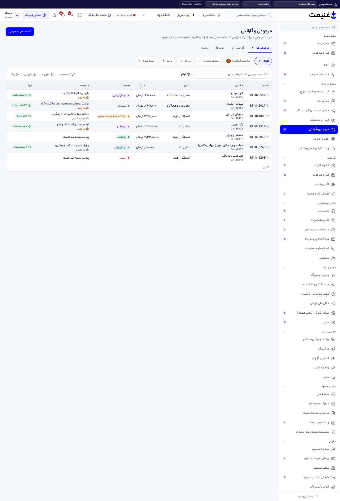
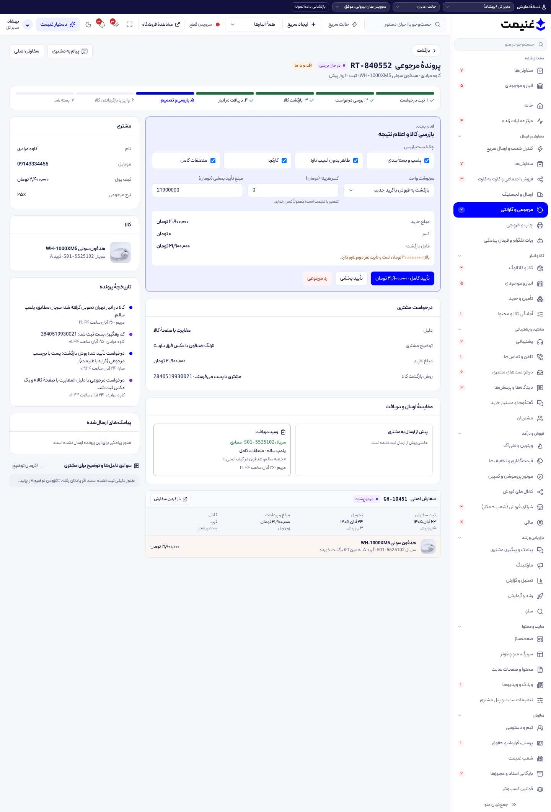
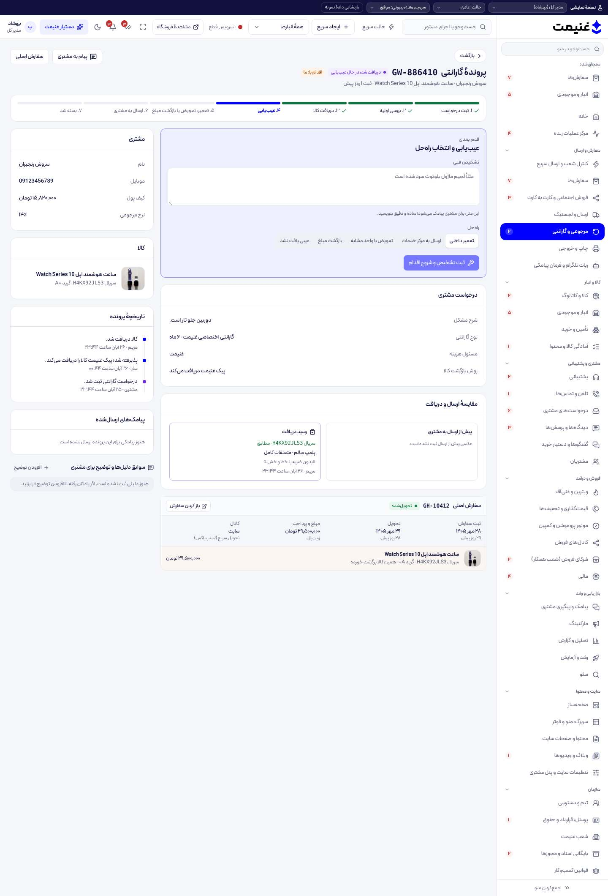

# نسخهٔ v1.1.0 · پرونده‌های مرحله‌به‌مرحلهٔ مرجوعی و گارانتی

- تاریخ: ۲۷ آبان ۱۴۰۵
- نسخهٔ قبلی: v1.0.0 (کامیت `f16d084`)
- پیش‌نمایش: https://behshad79.github.io/Ghanimat/

## خلاصه

1. **مرجوعی و گارانتی از یک جدول با منوی وضعیت به «پرونده» تبدیل شد.**
   - هر پرونده صفحهٔ خودش را دارد: نوار ۷ مرحله‌ای، کادر «قدم بعدی» با دکمه‌های همان مرحله، و برچسب «اقدام با» (ما، مشتری، پیک، مالی، مرکز خدمات).
   - هر دکمه برای مشتری پیامک می‌فرستد و در تاریخچهٔ پرونده و لاگ ممیزی ثبت می‌شود.
2. **تم پیش‌فرض همیشه روشن است** و دیگر از تم سیستم‌عامل پیروی نمی‌کند. تم تیره فقط با انتخاب کاربر فعال می‌شود.
3. **نام مسئول شعبهٔ مهاباد** در دادهٔ نمونه «یاسین» شد.

## صفحه‌ها و مسیرها

| مسیر | تغییر | تصویر |
|---|---|---|
| `/admin/returns` | صف‌های «نیازمند اقدام ما، منتظر مشتری، در راه، واریز، بسته‌شده»، ستون «قدم بعد»، زبانهٔ تازهٔ «روند کار»؛ کلیک روی ردیف پرونده را باز می‌کند |  |
| `/admin/returns/:id` | **تازه** · پروندهٔ مرجوعی |  |
| `/admin/returns/w/:id` | **تازه** · پروندهٔ گارانتی |  |

پنجرهٔ بازرسی مرجوعی و کشوی گارانتی حذف شدند. همهٔ قابلیت‌هایشان (چک‌لیست، سرنوشت واحد، تأیید بخشی، کسر هزینهٔ ارسال، رد با دلیل، مقایسهٔ عکس ارسال و دریافت، سفارش اصلی، سوابق دلیل) به صفحهٔ پرونده منتقل شده است. منوی سریع ردیف‌های گارانتی همچنان هست.

### مراحل مرجوعی

| # | مرحله | اقدام با | وضعیت‌ها | کار در این مرحله |
|---|---|---|---|---|
| ۱ | بررسی درخواست | ما | `return.registered` | بررسی خودکار مهلت، عکس و مقصر بودن؛ تأیید با انتخاب روش بازگشت (پیک غنیمت، پست با برچسب، تحویل حضوری)، درخواست عکس یا توضیح، یا رد با دلیل. تأیید خارج از مهلت یا بدون عکس فقط پس از تأیید دوباره ممکن است. |
| ۲ | بازگشت کالا | مشتری / پیک | `return.awaiting_customer`، `return.pickup_scheduled`، `return.awaiting_pickup` | ثبت کد رهگیری یا «پیک تحویل گرفت»، یادآوری، بستن پرونده با پایان مهلت (`return.expired`)، لغو به درخواست مشتری (`return.cancelled`) |
| ۳ | دریافت در انبار | ما | `return.in_transit` | رسید دریافت: تطبیق سریال (هشدار عدم تطابق)، پلمپ، متعلقات، دست‌کم یک عکس؛ وضعیت واحد ← `unit.returned` |
| ۴ | بازرسی و تصمیم | ما | `return.inspecting` | چک‌لیست، سرنوشت واحد، محاسبهٔ کسر پس‌کرایه؛ تأیید کامل، بخشی، با کسر هزینه، یا رد. مبلغ بالای `refund_cap` ← `return.approved` با ساخت درخواست تأیید. |
| ۵ | واریز یا بازگرداندن کالا | مالی / ما | `return.approved`، `return.refunding`، `return.partial`، `return.approved_deducted`، `return.rejected` | واریز به کیف پول (فوری)، شبا (با اعتبارسنجی ۲۴ رقم) یا برگشت درگاه (ثبت تراکنش `pay.refunded`)، با شمارهٔ پیگیری. در صورت رد، ارسال کالا به مشتری با کد رهگیری. |
| ۶ | بسته شد | — | `return.refunded`، `return.sent_back`، `return.expired`، `return.cancelled`، رد پیش از دریافت | خلاصهٔ واریز یا ارسال |

### مراحل گارانتی

| # | مرحله | اقدام با | وضعیت‌ها | کار در این مرحله |
|---|---|---|---|---|
| ۱ | بررسی اولیه | ما | `warranty.pending` | فعال بودن گارانتی (از تاریخ تحویل + مدت)، تطبیق سریال، موارد خارج از پوشش (ضربه، مایعات، دستکاری)؛ پذیرش با روش ارسال، درخواست مدارک، یا رد با دلیل |
| ۲ | دریافت کالا | مشتری / ما | `warranty.approved`، `warranty.in_transit` | کد رهگیری یا تحویل پیک؛ رسید دریافت با عکس (برای تحویل حضوری مستقیم) |
| ۳ | عیب‌یابی | ما | `warranty.received` | تشخیص فنی (برای مشتری پیامک می‌شود) و انتخاب راه‌حل: تعمیر داخلی، ارسال به مرکز خدمات، تعویض با واحد مشابه (واحد جایگزین `unit.reserved` می‌شود)، بازگشت مبلغ، عیبی یافت نشد |
| ۴ | تعمیر / تعویض / بازگشت مبلغ | ما / مرکز خدمات | `warranty.repairing`، `warranty.external`، `warranty.replaced` | ثبت پایان تعمیر یا بازگشت از مرکز خدمات با شرح کار |
| ۵ | ارسال به مشتری | ما / پیک | `warranty.ready`، `warranty.shipping_back` | روش و کد رهگیری؛ ثبت تحویل. برای بازگشت مبلغ، فرم واریز. |
| ۶ | بسته شد | — | `warranty.done`، `warranty.refunded`، `warranty.rejected` | پیامک نظرسنجی رضایت |

منطق مرحله‌ها و صف‌ها در `src/admin/returns/flow.ts` است (`retStage`، `warStage`، `inQueue`) و باید عیناً سمت سرور هم پیاده شود.

## مدل داده

| مجموعه | فیلد | تغییر | نوع |
|---|---|---|---|
| `returns`، `warranties` | `method` | تازه | `'courier' \| 'post' \| 'inperson'` |
| `returns`، `warranties` | `tracking`، `pickupAt` | تازه | string |
| `returns`، `warranties` | `receipt` | تازه | `{ at, by, serial, serialOk, sealOk, accOk, photos[], note }` |
| `returns`، `warranties` | `refund` | تازه | `{ amount, dest, account?, ref?, at?, by?, deduct? }` |
| `returns`، `warranties` | `back` | تازه | `{ method, tracking?, courier?, at }` (ارسال به مشتری) |
| `returns`، `warranties` | `events` | تازه | `{ at, by, text, who }[]` (تاریخچهٔ پرونده) |
| `returns`، `warranties` | `checks` | تازه | `Record<string, boolean>` |
| `returns` | `fate`، `courierName` | تازه | string |
| `warranties` | `diagnosis`، `resolution`، `center`، `replaceUnitId`، `repairNote` | تازه | string |

تایپ‌ها در `src/shared/data/seed.ts` (`CaseFlow`، `CaseReceipt`، `CaseRefund`، `CaseShip`، `CaseEvent`). دادهٔ نمونه: ۳ مرجوعی و ۲ گارانتی تازه در مرحله‌های مختلف.

## وضعیت‌های تازه

| کد | برچسب |
|---|---|
| `return.pickup_scheduled` | پیک غنیمت در راه دریافت |
| `return.sent_back` | کالا به مشتری بازگردانده شد |
| `warranty.received` | دریافت شد، در حال عیب‌یابی |
| `warranty.external` | نزد مرکز خدمات شرکت |
| `warranty.ready` | آمادهٔ ارسال به مشتری |
| `warranty.shipping_back` | در راه مشتری |

## عملیات و API پیشنهادی

| endpoint | توضیح |
|---|---|
| `POST /returns/{id}/approve` | `{ method }` · ارسال دستورالعمل با پیامک |
| `POST /returns/{id}/request-info` | `{ text }` |
| `POST /returns/{id}/reject` | `{ reasonCode, reasonText }` |
| `POST /returns/{id}/tracking` | `{ tracking }` یا `{ courier }` |
| `POST /returns/{id}/remind`، `/expire`، `/cancel` | — |
| `POST /returns/{id}/receipt` | `CaseReceipt` (با آپلود عکس) |
| `POST /returns/{id}/decide` | `{ mode: full\|partial\|deduct\|reject, amount, fate, checks, reason }` |
| `POST /returns/{id}/refund` | `{ dest, account?, ref? }` · کیف پول، شبا یا برگشت درگاه |
| `POST /returns/{id}/ship-back` | `{ method, tracking }` |
| `POST /warranties/{id}/approve`، `/request-info`، `/reject` | مانند مرجوعی |
| `POST /warranties/{id}/receipt` | `CaseReceipt` |
| `POST /warranties/{id}/diagnose` | `{ diagnosis, resolution, center?, replaceUnitId? }` |
| `POST /warranties/{id}/repaired` | `{ note }` |
| `POST /warranties/{id}/ship-back`، `/delivered`، `/refund` | — |
| `POST /{returns\|warranties}/{id}/message` | پیامک آزاد به مشتری |

خط دقیق هر عملیات در کد: بخش `src/admin/returns/Case.tsx` در [06-api-contract.md](../developer/06-api-contract.md).

## تم

- `src/shared/lib/store.ts`: تشخیص تم سیستم (`prefers-color-scheme`) حذف شد و پیش‌فرض `light` است.
- کلید نشست به `ghanimat-demo-session-v2` و کلید داده به `ghanimat-demo-db-v47` رفت تا تم و دادهٔ قبلی مرورگرها پاک شود.
- در تولید هم پیش‌فرض روشن باشد و انتخاب تیره به‌عنوان ترجیح کاربر سمت سرور ذخیره شود.

## کارهای توسعه

- [ ] مهاجرت پایگاه‌داده: فیلدهای تازهٔ `returns` و `warranties` (بالا) و جدول یا فیلد `events` برای تاریخچهٔ پرونده.
- [ ] افزودن ۶ کد وضعیت تازه به enum وضعیت‌ها.
- [ ] پیاده‌سازی ماشین حالت پرونده سمت سرور بر اساس `flow.ts`؛ هیچ انتقالی خارج از جدول مراحل مجاز نباشد.
- [ ] endpointهای جدول «عملیات و API» با بررسی دسترسی ماژول `returns` و مجوز بازگشت وجه.
- [ ] قانون سقف بازگشت وجه (`refund_cap`) و ساخت خودکار درخواست تأیید.
- [ ] آپلود و نگهداری عکس رسید دریافت.
- [ ] واریز: افزودن به کیف پول، اعتبارسنجی و استعلام شبا، برگشت تراکنش درگاه.
- [ ] قالب پیامک هر مرحله (متن‌ها در `Case.tsx`) در سرویس پیامک.
- [ ] رزرو خودکار واحد جایگزین در تعویض گارانتی؛ تغییر وضعیت واحد در دریافت، بازرسی و ارسال برگشت.
- [ ] صفحه‌های `/admin/returns/:id` و `/admin/returns/w/:id` و صف‌های فهرست.
- [ ] تم پیش‌فرض روشن؛ حذف هر وابستگی به تم سیستم‌عامل.
- [ ] مسیر «دریافت مرجوعی» در حالت ساده حالا رسید دریافت ثبت می‌کند (`src/admin/simple/Simple.tsx`).

## فایل‌های تغییرکرده (کد)

- `src/admin/returns/flow.ts` (تازه)
- `src/admin/returns/Case.tsx` (تازه)
- `src/admin/pages/Ops.tsx` (فهرست مرجوعی و گارانتی، راهنمای روند)
- `src/App.tsx` (دو مسیر تازه)
- `src/shared/data/seed.ts` (تایپ‌ها و دادهٔ نمونه)
- `src/shared/data/statuses.ts`
- `src/shared/data/partners.ts`، `remote.ts`، `cx.ts` (نام شعبهٔ مهاباد)
- `src/shared/lib/store.ts` (تم و کلیدها)
- `src/admin/simple/Simple.tsx`، `src/shared/ui/quickview.tsx` (لینک به پرونده)
- مستندات و تصاویر بازتولید شدند.
