# نسخهٔ v1.3.0 · تطبیق کامل با فیگما، ایجنت‌های هوش مصنوعی، صفحهٔ کالا و وبلاگ

- تاریخ: ۲۷ آبان ۱۴۰۵
- نسخهٔ قبلی: v1.2.0 (کامیت `58cdfda`؛ `git diff 58cdfda v1.3.0`)
- پیش‌نمایش: https://behshad79.github.io/Ghanimat/

## خلاصه

1. **مرجوعی و گارانتی عیناً مطابق پنل کاربری فیگما بازسازی شد.** مرحله‌ها، وضعیت‌ها، فیلدهای فرم، دلیل‌ها، متن تاریخچه و پیامک‌ها همان متن فیگماست. بازرسی هر قلم جداست، ارسال دوباره مرسولهٔ تازه‌ای در همان سفارش می‌سازد، و دفتر کارت‌های گارانتی با استعلام اضافه شده است.
2. **تصمیم مشتری در کمبود تأمین** («نیازمند تصمیم شما» در سفارش‌های جاری) با سه حالت پیاده شد: تأمین نشد، ناموجود، در انبار دیگر موجود است. انتخاب مشتری (یا ثبتش از طرف پشتیبانی) اثر واقعی دارد و با پایان مهلت، سیستم خودکار لغو می‌کند.
3. **لغو سفارش** با پیام عذرخواهی، کد تخفیف جبرانی و «خبرم کن»، به‌علاوهٔ پیگیری بازگشت وجه (در جریان، انجام‌شده با شمارهٔ پیگیری، ناموفق و تغییر مقصد به کیف پول). کالای لغوشده از سفارش حذف نمی‌شود؛ برچسب «لغو شد» می‌گیرد.
4. **ماژول ایجنت‌ها و اتوماسیون:**
   - حساب ایجنت با سطح دسترسی و توکن؛
   - صندوق کارها با صف تأیید انسانی؛
   - پلی‌بوک‌ها، اتوماسیون‌ها، لاگ فعالیت و راهنمای اتصال.
5. **صفحهٔ کالا مطابق فیگما:**
   - مبدأ و مسیر واردات با فاکتور خرید؛
   - کنترل کیفیت دو لایه؛
   - نمودار قیمت با ثبت خودکار هر تغییر قیمت؛
   - تنظیمات «صفحهٔ کالا»: بیمهٔ سفارش، کادر اقساط، کانال‌های اشتراک‌گذاری، هشدار موجودی؛
   - کالاهای مشابه و «معمولاً با هم خریده می‌شوند».
6. **وبلاگ:** بخش‌بندی زمانی ویدیوها، مطالب ترند، جست‌وجوهای بی‌نتیجه و برچسب‌های پرطرفدار.
7. **موارد کوچک‌تر:**
   - بستن تیکت به‌دلیل پاسخ ندادن مشتری؛
   - وضعیت‌های «اصلاح پس از رد» و «ویرایش» در حساب حقوقی؛
   - آزمایش کد تخفیف با پیام‌های فیگما؛
   - وضعیت «در انتظار تأیید اعتبار اقساطی»؛
   - کارت‌های KPI داخل پنجره‌ها به‌اندازهٔ عرض پنجره چیده می‌شوند.
8. **رفع باگ:** با رفتن از ویرایش یک کالا به ویرایش کالای دیگر، فرم اطلاعات کالای قبلی را نگه می‌داشت؛ حالا برای هر کالا از نو ساخته می‌شود.

## صفحه‌ها و مسیرها

| مسیر | تغییر | تصویر |
|---|---|---|
| `/admin/returns` | زبانه‌های مرجوعی، گارانتی، **کارت‌های گارانتی** (استعلام، فیلتر، ابطال)، روند کار (متن فیگما)، آمار | 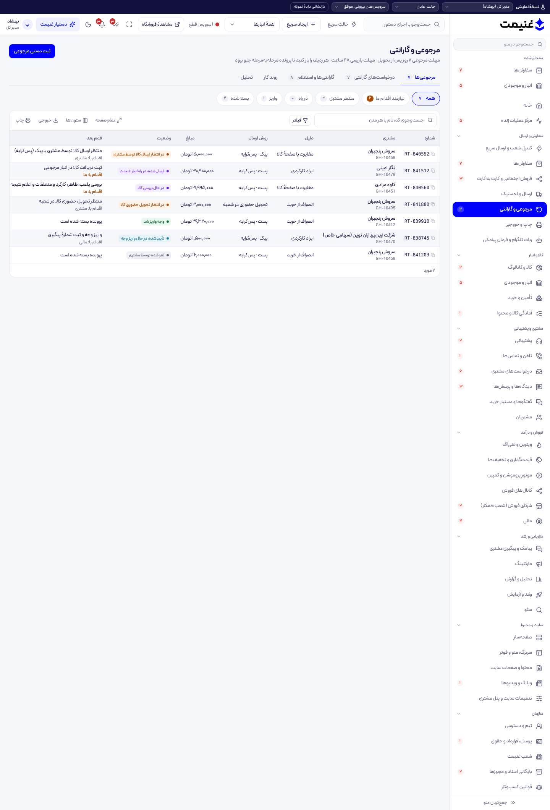 |
| `/admin/returns/:id` | پروندهٔ مرجوعی با ۴ مرحلهٔ فیگما؛ بازرسی هر قلم؛ ارسال دوباره به‌صورت مرسولهٔ تازه | 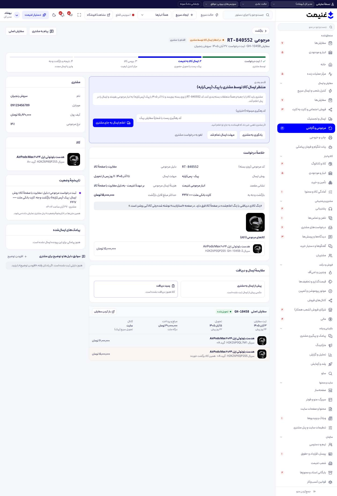 |
| `/admin/returns/w/:id` | پروندهٔ گارانتی با ۶ مرحلهٔ فیگما؛ تعویض، تعمیر، ارسال به مشتری، بازگشت وجه | 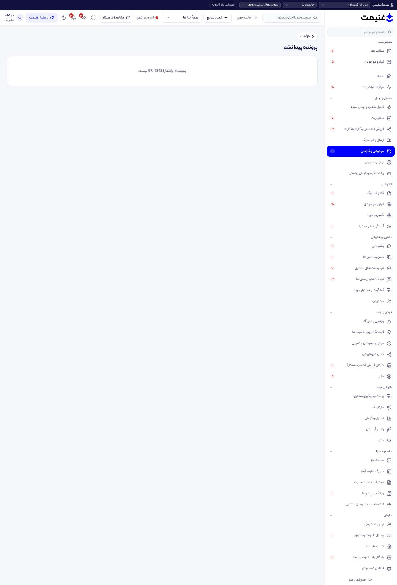 |
| `/admin/orders` | زبانهٔ «در انتظار پرداخت یا اعتبار» | 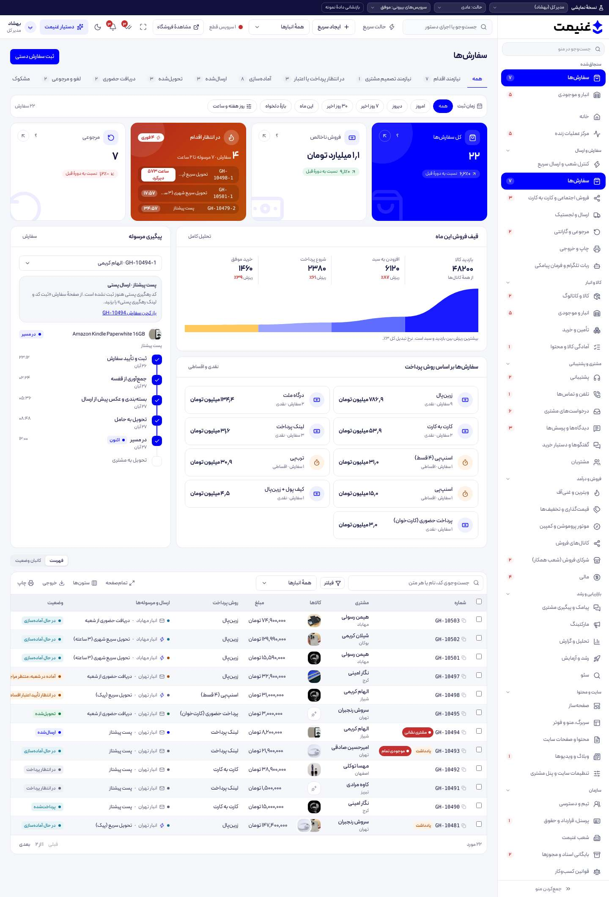 |
| `/admin/orders/:id` | پنل «تصمیم مشتری»، «اعلام کمبود به مشتری»، خلاصهٔ لغو و بازگشت وجه | 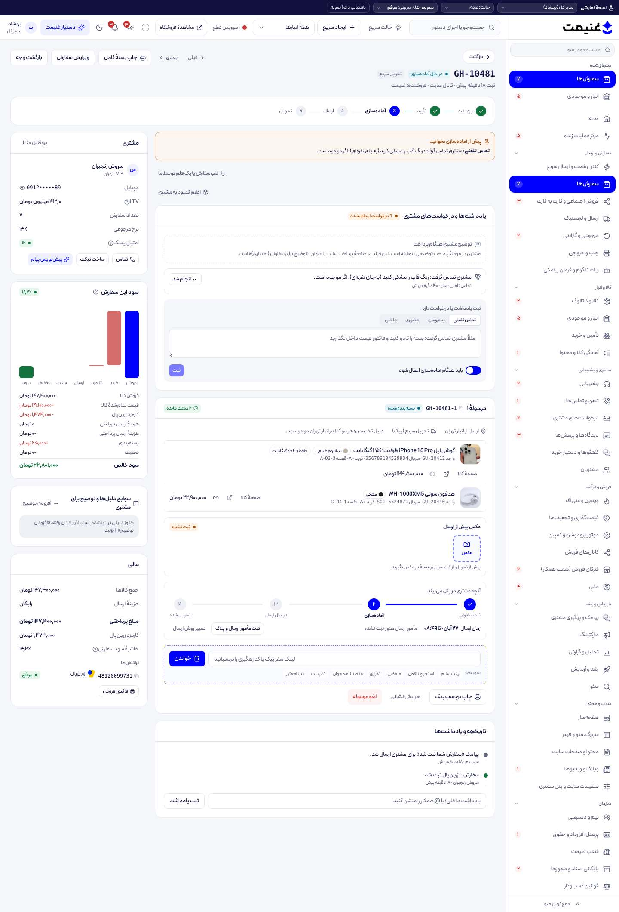 |
| `/admin/agents` | **تازه** · ایجنت‌ها، کارها، پلی‌بوک‌ها، اتوماسیون، لاگ، اتصال | 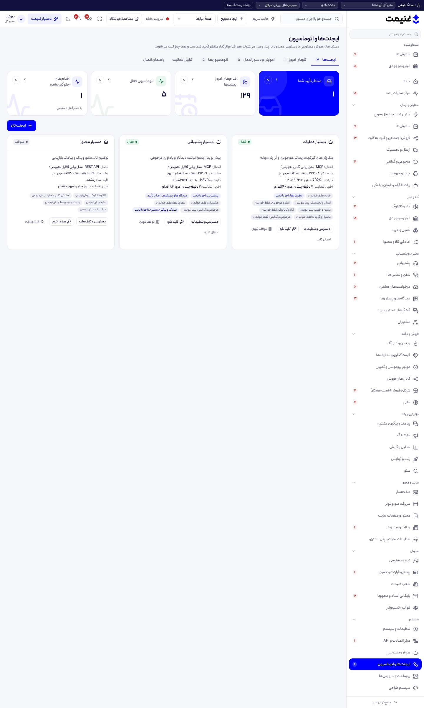 |
| `/admin/catalog/:id` | زبانه‌های تازهٔ «نمودار قیمت» و «مسیر واردات و QC» | 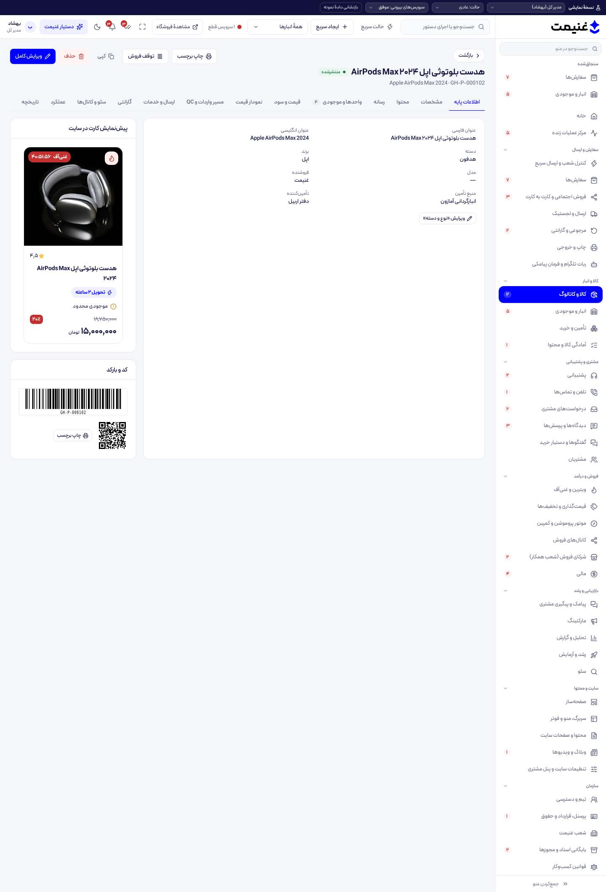 |
| `/admin/catalog/:id/edit` | گام «وضعیت و منبع»: مسیر واردات و QC دو لایه؛ گام «کانال‌ها»: نمایش نمودار قیمت | 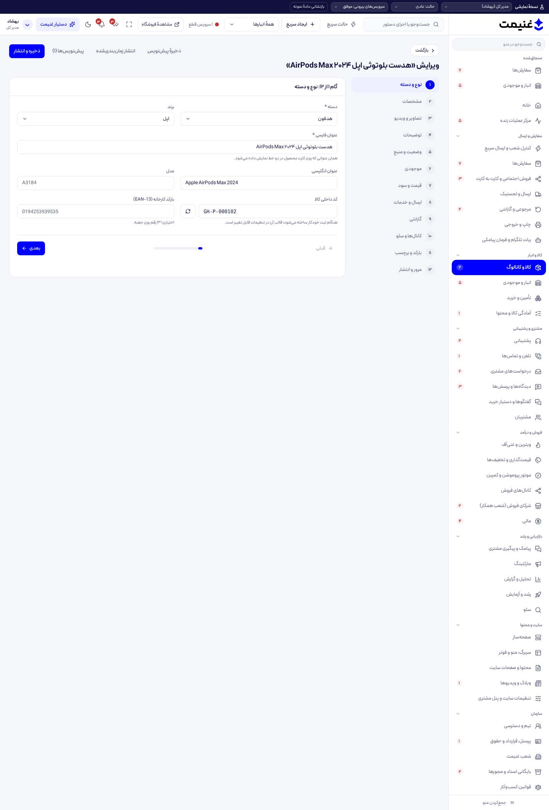 |
| `/admin/catalog?tab=pim` | کالاهای مشابه، «معمولاً با هم خریده می‌شوند» | 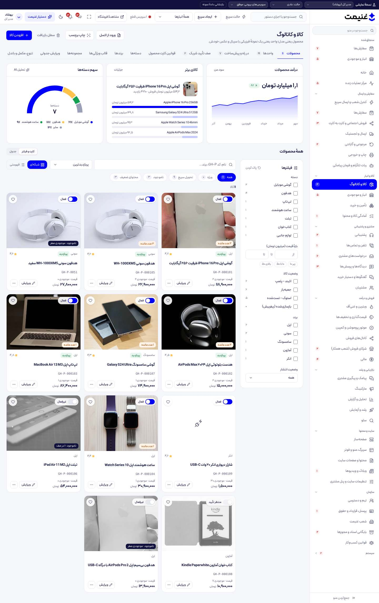 |
| `/admin/settings?tab=pdp` | **تازه** · تنظیمات صفحهٔ کالا | 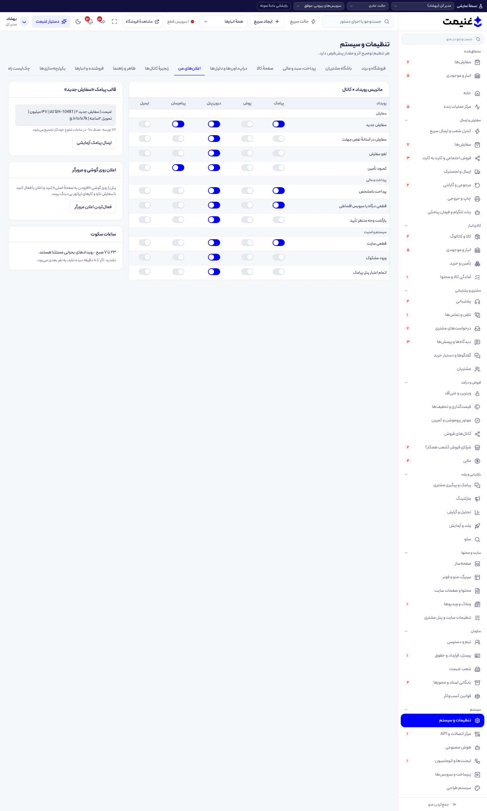 |
| `/admin/blog` | زبانهٔ «جست‌وجو و برچسب‌ها»، ترندها، بخش‌های ویدیو | 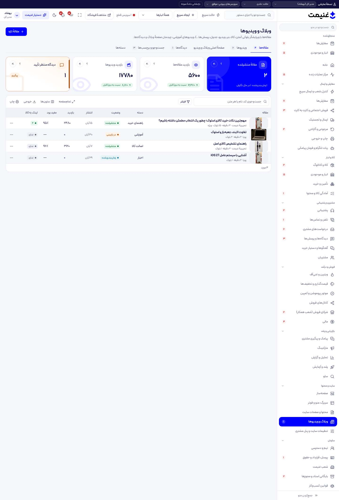 |
| `/admin/support` | دکمهٔ «بستن به‌دلیل پاسخ ندادن» | 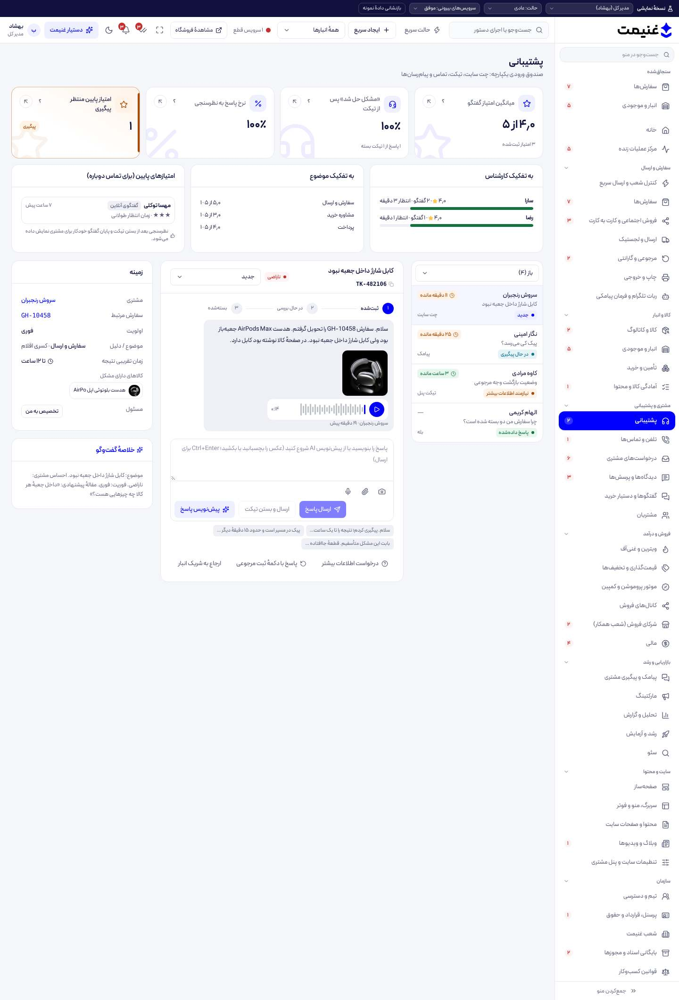 |
| `/admin/pricing` | آزمایش کد تخفیف برای یک مشتری، ستون انقضا و سقف هر مشتری | 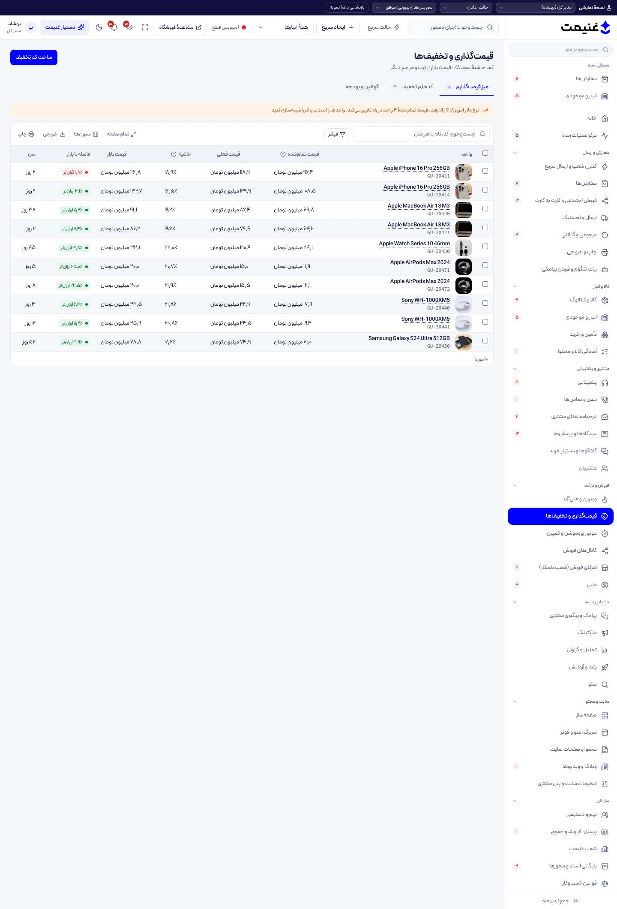 |

## مدل داده

| مجموعه | فیلد | تغییر | نوع |
|---|---|---|---|
| `returns` | `items` | تازه | `RetItem[]` `{ productId, unitId, qty, price, shipId?, ok?, why? }` |
| `returns` | `refundTo` | تازه | `{ kind: 'wallet' } \| { kind: 'card', bank, last4, holder? }` |
| `warranties` | `code`، `type`، `months` | تازه | کارت گارانتی وابسته |
| `wcards` | — | **مجموعهٔ تازه** | `{ code, unitId, productId, customerId, orderId, type, provider, months, start, status: 'active'\|'expired'\|'invalid', invalidReason?, notes[] }` |
| `orders` | `decision` | تازه | `OrderDecision` `{ kind, items[], alt?, deadline, at, by, choice?, chosenBy?, chosenAt?, refund?, error? }` |
| `orders` | `cancelInfo` | تازه | `CancelInfo` `{ by, reason, at, amount, to, refund, ref?, refundAt?, failWhy?, apology?, code?, notify?, partial? }` |
| `orders.shipments.items` | `cancelled`، `cancelBy` | تازه | boolean، string |
| `agents` | — | **مجموعهٔ تازه** | حساب‌ها، توکن‌ها، کارها، پلی‌بوک‌ها، اتوماسیون‌ها، لاگ (`src/shared/data/agents.ts`) |
| `products.pdp` | `route` | تازه | `ImportRoute` `{ origin: 'amazon'\|'store', store, seller, boughtAt, inbound: 'tehran'\|'baneh', inAt, transferAt?, invoice?, invoiceOk? }` |
| `products.pdp` | `qc` | تازه | `Record<string, boolean>` (موارد `QC_LAYERS`) |
| `products.pdp` | `showPriceChart`، `similar` | تازه | boolean، `string[]` |
| `priceLog` | — | **مجموعهٔ تازه** | `PricePoint` `{ pid, at, price, by }` |
| `storeCfg.pdp` | — | تازه | بیمه، اقساط، نمودار قیمت، `lowStock`، `lastUpdate`، `share`، کلیدهای نمایش |
| `blog.posts` | `trend` | تازه | boolean |
| `blog.videos` | `chapters` | تازه | `{ t, from, to }[]` |
| `blog.landing` | `popularTags`، `trendTitle`، `noResult` | تازه | |
| `blog.searches` | — | تازه | `{ q, n, results, at }[]` |
| `cx.reportReasons` | متن دلیل‌ها | تغییر | مطابق فیگما؛ «وضعیت کالا درست نیست» اضافه شد |

کلید دادهٔ نمونه `ghanimat-demo-db-v52` شد. کلید نشست `ghanimat-demo-session-v2` است.

## وضعیت‌ها و قانون‌ها

### وضعیت‌های تازه
- `order.awaiting_credit`: در انتظار تأیید اعتبار اقساطی.
- مرجوعی، مطابق فیگما:
  - `return.awaiting_customer`، `return.awaiting_pickup`، `return.in_transit`، `return.inspecting`؛
  - `return.approved`، `return.refunding`، `return.approved_deducted`؛
  - `return.rejected`، `return.refunded`، `return.cancelled`.
- گارانتی، مطابق فیگما:
  - `warranty.reviewing`، `warranty.received`، `warranty.repairing`؛
  - `warranty.replaced`، `warranty.shipping_back`؛
  - `warranty.done`، `warranty.rejected`، `warranty.closed`.

### قانون‌ها
- **مرجوعی:**
  - روش بازگشت و مقصد وجه (کیف پول یا کارت) را مشتری انتخاب می‌کند.
  - در «انصراف از خرید»، هزینهٔ ارسال اولیه برگردانده نمی‌شود. پیش از راه‌اندازی این قاعده با مادهٔ ۳۷ قانون تجارت الکترونیکی تطبیق داده شود.
- **تصمیم مشتری:**
  - مهلت دارد.
  - با پایان مهلت، `applyDecision(..., 'cancel_all', 'سیستم')` اجرا می‌شود.
  - «از انبار دیگر» مرسولهٔ تازهٔ پستی با SLA ۷۲ ساعته می‌سازد.
- **لغو توسط غنیمت:**
  - عذرخواهی ثبت می‌شود و کد جبرانی اختیاری است.
  - کالا با `cancelled: true` می‌ماند.
  - بازگشت وجه سه حالت دارد و هر کدام پیامک دارد.
- **نشان «از هر دو لایهٔ QC عبور کرده»:** فقط وقتی همهٔ موارد `qcItems(sealed)` تیک خورده باشد. برای کالای پلمپ، «روشن‌کردن و تست» لازم نیست.
- **نمودار قیمت:** با کمتر از `storeCfg.pdp.priceChart.minPoints` نقطه در بازه نمایش داده نمی‌شود. هر تغییر قیمت فقط وقتی ثبت می‌شود که با آخرین قیمت فرق داشته باشد (`logPrice`).
- **بیمهٔ سفارش:** `clamp(price × rate٪، min، max)` و فقط برای کالای بالای `minPrice`.

## عملیات و API

| endpoint پیشنهادی | عملیات در کد | توضیح |
|---|---|---|
| `POST /returns/{id}/...` | `src/admin/returns/Case.tsx` (`act`) | هر دکمهٔ مرحله، رویداد تاریخچه و پیامک |
| `GET /warranty-cards?code=` | `src/admin/pages/Ops.tsx` (`WarrantyCards`) | استعلام کارت گارانتی |
| `POST /orders/{id}/decision` | `src/admin/orders/Decision.tsx` (`StartDecision`) | اعلام کمبود و مهلت |
| `POST /orders/{id}/decision/apply` | `Decision.tsx` (`applyDecision`) | `{ choice: 'send_rest'\|'from_other'\|'cancel_all', by }` |
| `POST /orders/{id}/cancel` | `src/admin/orders/OrderEvents.tsx` (`CancelModal`) | با عذرخواهی، کد جبرانی و notify |
| `PATCH /orders/{id}/refund` | `OrderEvents.tsx` (`CancelSummary`) | ثبت شمارهٔ پیگیری، ناموفق، تغییر مقصد |
| `POST /tickets/{id}/close-no-reply` | `src/admin/cx/TicketExtras.tsx` (`NoReplyCloseButton`) | |
| `POST /coupons/test` | `src/admin/pages/Revenue.tsx` (`CodeTester`) | پیام خطا یا موفقیت مطابق فیگما |
| `/agents/*` | `src/admin/agents/Agents.tsx` | توکن با دامنهٔ دسترسی؛ اجرای پیشنهاد فقط پس از تأیید انسانی |
| `PUT /products/{id}/route`، `PUT /products/{id}/qc` | `src/admin/catalog/PdpExtras.tsx` | مسیر واردات و QC |
| `GET /products/{id}/price-history?range=` | `PdpExtras.tsx` (`PriceChart`) | |
| `POST /products/{id}/price` | `Wizard.tsx`، `CatalogPro.tsx`، `PriceWatch.tsx` | هر تغییر قیمت ← ردیف `priceLog` |
| `PUT /settings/pdp` | `src/admin/settings/StoreSettings.tsx` (`ProductPageRules`) | |
| `GET /blog/searches` | `src/admin/blog/Blog.tsx` | |

## سیستم طراحی

- در `styles.css`: `[data-dialog-body] .grid:has(> [data-kpi])` کارت‌های KPI داخل پنجره و کشو را به‌اندازهٔ عرض واقعی آن‌ها می‌چیند (حداقل ۲۶۰ پیکسل).
- کامپوننت تازه‌ای به سیستم طراحی اضافه نشده است. همهٔ صفحه‌های تازه از `Card`، `Field`، `Segmented`، `Toggle`، `DataTable` و `Area` ساخته شده‌اند.

## کارهای توسعه

- [ ] پیاده‌سازی سمت سرور مرحله‌های مرجوعی و گارانتی بر اساس `retStage`، `warStage` و `inQueue` در `flow.ts`.
- [ ] زمان‌بند لغو خودکار پس از پایان مهلت تصمیم مشتری.
- [ ] اتصال لغو اقلام سفارش اقساطی به API لغو یا اصلاح سرویس اقساطی (اسنپ‌پی، ترب‌پی، دیجی‌پی).
- [ ] جدول `price_history` و ثبت آن در همهٔ مسیرهای تغییر قیمت (از جمله قیمت‌گذاری خودکار).
- [ ] نگهداری فاکتور خرید در فضای خصوصی؛ فقط عبارت «ثبت‌شده در سوابق کالا» عمومی است.
- [ ] ایجنت‌ها: صدور توکن با دامنه، ثبت همهٔ اقدام‌ها در لاگ ممیزی، و اجرای پیشنهادهای حساس فقط پس از تأیید.
- [ ] جمع‌آوری عبارت‌های جست‌وجوی وبلاگ (با تعداد نتیجه) برای زبانهٔ «جست‌وجو و برچسب‌ها».
- [ ] محاسبهٔ «معمولاً با هم خریده می‌شوند» به‌صورت شبانه از سفارش‌ها.

## فایل‌های تغییرکرده

```
 src/App.tsx                          |   2 +
 src/admin/agents/Agents.tsx          | 242 +++++++++++++++
 src/admin/blog/Blog.tsx              |  27 +-
 src/admin/catalog/Catalog.tsx        |   5 +-
 src/admin/catalog/PdpExtras.tsx      | 102 +++++++
 src/admin/catalog/Wizard.tsx         |  11 +-
 src/admin/cx/TicketExtras.tsx        |  15 +-
 src/admin/orders/Decision.tsx        | 102 +++++++
 src/admin/orders/OrderEvents.tsx     |  37 ++-
 src/admin/orders/ReturnTools.tsx     |  94 +++---
 src/admin/pages/Ops.tsx              |  85 ++++--
 src/admin/pages/Orders.tsx           |  22 +-
 src/admin/pages/Org.tsx              |   5 +-
 src/admin/pages/People.tsx           |   6 +-
 src/admin/pages/Revenue.tsx          |  25 +-
 src/admin/pro/CatalogPro.tsx         |   5 +-
 src/admin/pro/PriceWatch.tsx         |   3 +-
 src/admin/returns/Case.tsx           | 566 ++++++++++++++++++++---------------
 src/admin/returns/flow.ts            | 107 ++++---
 src/admin/settings/StoreSettings.tsx |  65 +++-
 src/admin/shell/nav.ts               |   3 +-
 src/shared/data/agents.ts            |  73 +++++
 src/shared/data/blog.ts              |  16 +-
 src/shared/data/cx.ts                |   4 +-
 src/shared/data/seed.ts              |  94 ++++--
 src/shared/data/statuses.ts          |  44 ++-
 src/shared/data/storeCfg.ts          |   8 +
 src/shared/lib/store.ts              |   2 +-
 src/shared/ui/overlay.tsx            |   4 +-
 src/shared/ui/page.tsx               |   2 +-
 src/styles.css                       |   3 +
 31 files changed, 1350 insertions(+), 429 deletions(-)
```

به‌علاوهٔ مستندات بازتولیدشده در `docs/` و ۷۰ تصویر صفحه در `docs/screens/`.
