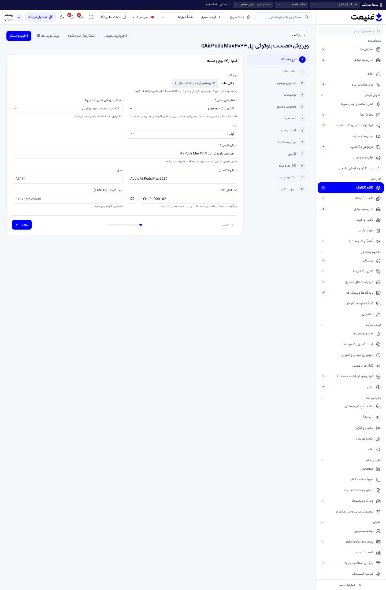
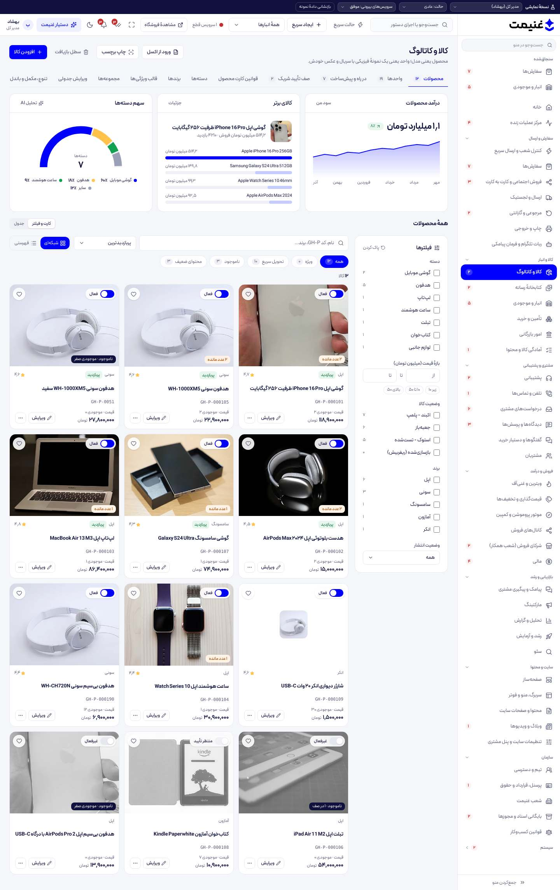
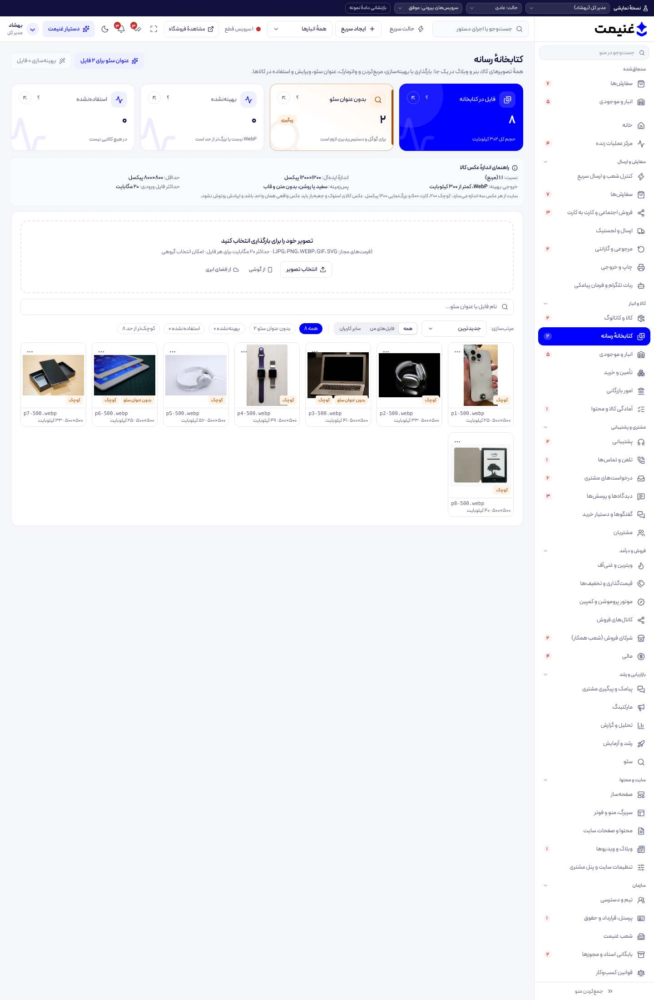
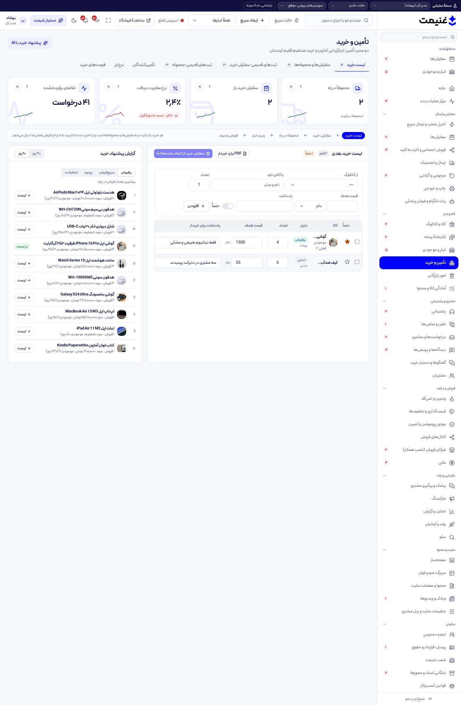
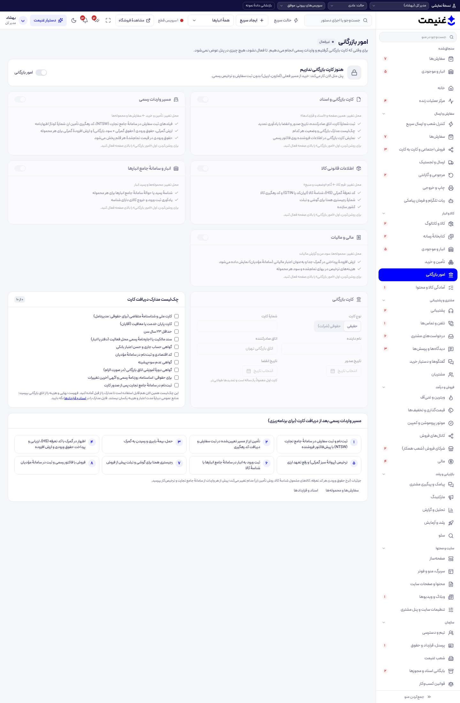
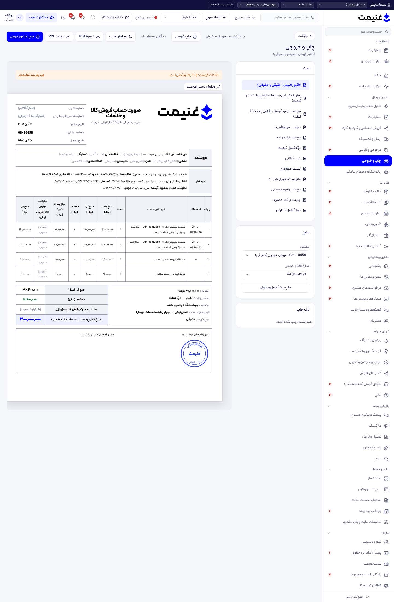
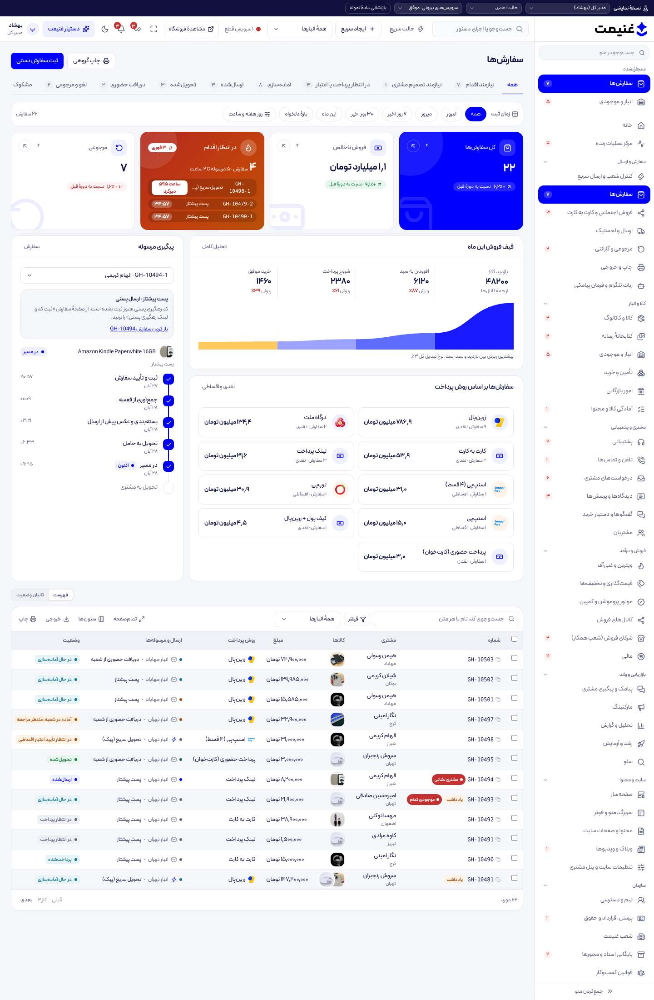
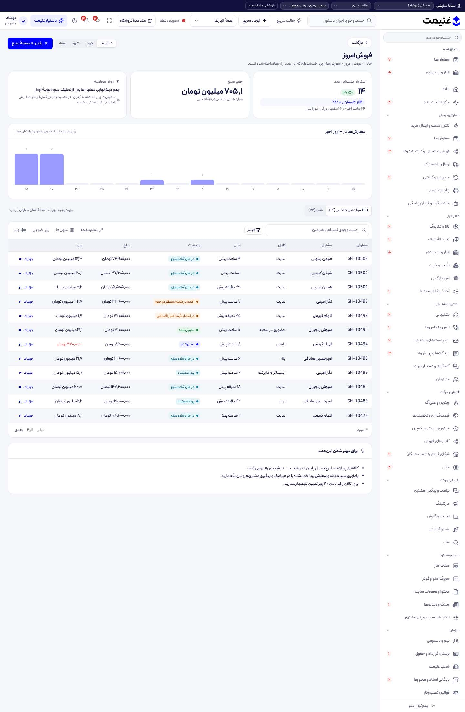
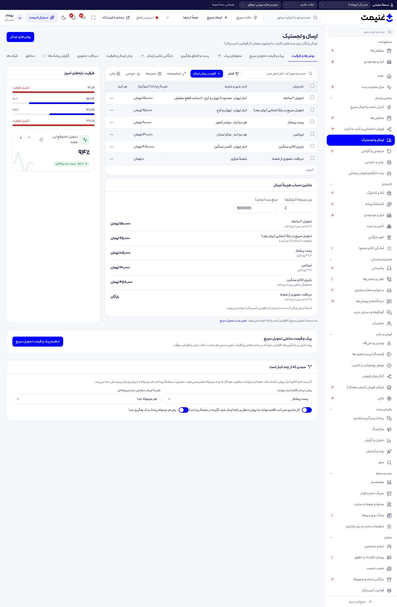
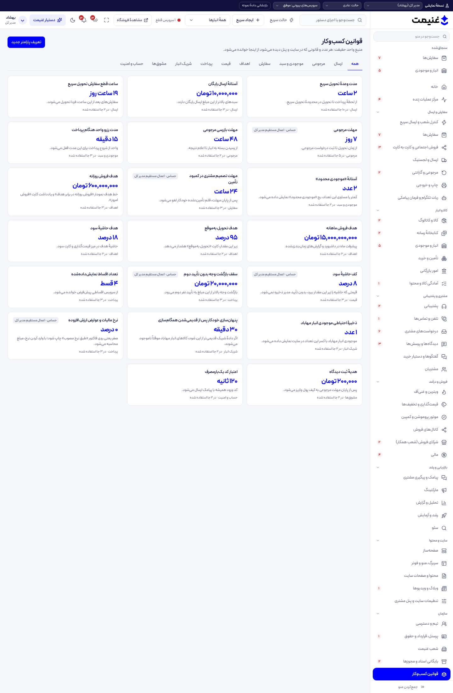

# نسخهٔ v1.4.0 · کالای متغیر، تأمین تا سود، امور بازرگانی، چاپ گروهی و کارت‌های شاخص با دادهٔ واقعی

- تاریخ: ۲۸ آبان ۱۴۰۵
- نسخهٔ قبلی: v1.3.0 (کامیت `b0db8da`؛ `git diff b0db8da v1.4.0`)
- پیش‌نمایش: https://behshad79.github.io/Ghanimat/

## خلاصه

1. **کالای متغیر (الگوی ووکامرس):**
   - ویژگی‌ها و مقدارها با انتخابگر رنگ گرادیانی؛
   - برای هر تنوع: کد پسوند، بارکد، قیمت و حراج، موجودی جدا در هر انبار، تصویر و وزن؛
   - قیمت خرید ارزی و سود هر تنوع؛
   - پیش‌نمایش زندهٔ صفحهٔ کالا.
   - **قاعدهٔ ارسال:** ارسال سریع فقط وقتی پیشنهاد می‌شود که همان تنوع در انبار تهران موجود باشد. در غیر این صورت پست پیشتاز، پیش‌خرید یا «خبرم کن» نشان داده می‌شود.
2. **فرم کالا:**
   - انتخاب درختی دسته و زیردسته، با ساخت دستهٔ تازه همان‌جا؛
   - افزودن مشخصات، با توضیح فرق مشخصات و ویژگی تنوع؛
   - کتابخانهٔ رسانه با بهینه‌سازی، مربع‌کردن، واترمارک، عنوان سئو و ویرایشگر تصویر؛
   - پر شدن خودکار نرخ ارز از API روزانه، با امکان تغییر دستی؛
   - مقایسهٔ بهای تمام‌شده با نرخ روز خرید و نرخ امروز. قیمت سایت هیچ‌وقت خودکار تغییر نمی‌کند.
3. **قیمت‌گذاری مجدد ارزی:**
   - پیشنهاد قیمت با حفظ حاشیه یا حاشیهٔ هدف؛
   - سقف پیشنهاد کمترین قیمت ترب و ایمالز است و کف آن حداقل حاشیهٔ فروشگاه؛
   - تأیید یا رد ردیف به ردیف، یا گروهی.
4. **تأمین و خرید با یک مسیر واحد:** لیست خرید ← سفارش خرید ← محموله در راه ← رسید انبار ← فروش و سود.
   - **لیست خرید روزانه:** علامت «حتماً»، گزارش پرفروش، سریع‌فروش، پرسود و تمام‌شده، و PDF برای خریدار.
   - **دفتر محموله:** قیمت ارزی هر قلم، پخش هزینه‌ها به نسبت ارزش، بهای تمام‌شده، فروش (تخمین اول‌وارد اول‌خارج)، سود و موجودی باقی‌مانده.
   - جدول‌های قدیمی سفارش خرید و محموله فقط برای سابقه نگه داشته شده‌اند.
5. **امور بازرگانی (برای آیندهٔ کارت بازرگانی):**
   - پیش‌فرض خاموش است؛ یک کلید اصلی و پنج بخش جدا دارد.
   - با روشن شدن هر بخش، فیلدها و محاسبه‌های همان بخش فعال می‌شود:
     - شناسه‌های قانونی کالا؛
     - ثبت سفارش، تأمین ارز، کوتاژ و حقوق ورودی در بهای تمام‌شده؛
     - شناسهٔ سامانهٔ جامع انبارها؛
     - ارزش افزودهٔ گمرک به‌عنوان اعتبار مالیاتی.
   - صفحه شامل چک‌لیست مدارک و مسیر ۸ مرحله‌ای واردات رسمی است.
6. **چاپ گروهی:**
   - انواع سند: فاکتور، پیش‌فاکتور، برچسب پست و پیک، رسید تحویل حضوری، فهرست جمع‌آوری و مانیفست؛
   - انتخاب سفارش بر اساس بازهٔ تاریخ، وضعیت و انبار، یا تیک‌زدن روی همان صفحه؛
   - خروجی PDF در اندازه‌های A4 تا رول ۵۸ میلی‌متری؛
   - چاپ در پنجرهٔ جدا.
7. **کارت‌های شاخص با دادهٔ واقعی:** حدود ۱۹۰ کارت در ۳۸ صفحه، هر کدام به ردیف‌های واقعی پشت عدد خودش می‌رود. نمونه‌ها: بدهی شعب به تفکیک محموله، لیست پیام‌ها، ماندگاری، ریزش و صفحه‌های خروج، منابع ورود و CAC، طلب از درگاه‌ها، پرسنل و اسناد. کارت‌های اصلی پنل تحلیلی هم دارند.
8. **تحویل سریع ۲ ساعته:**
   - قیمت جدا برای هر منطقه یا شهر، با سقف، هزینهٔ پیک و حاشیه؛
   - مرز هر مقصد روی نقشه، به‌صورت چندضلعی یا شعاع از انبار؛
   - تشخیص آنی محدوده از پین مشتری یا متن نشانی؛
   - خارج از همهٔ محدوده‌ها، پیک ۲ ساعته پیشنهاد نمی‌شود.
9. **سفارش‌ها:**
   - فیلترهای تاریخ، نوع پرداخت، شهر، انبار، روش ارسال، نوع خریدار، تخفیف، تعداد قلم و چاپ‌شده؛
   - برچسب فارسی وضعیت‌ها به‌جای کد خام؛
   - لوگوی بانک‌ها، درگاه‌ها و سرویس‌های اقساطی؛
   - نوع وسیلهٔ پیک با قالب پلاک موتور و سواری.
10. **بارگذاری از گوشی (QR) و فضای ابری** (گوگل درایو، وان‌درایو، آی‌کلود، دراپ‌باکس) در همهٔ بخش‌های بارگذاری.
11. **مدیر کل** تغییرهای حساس را مستقیم اعمال می‌کند: قانون‌ها، کاهش گروهی قیمت و سقف بازگشت وجه. برای بقیهٔ نقش‌ها تأیید دومرحله‌ای سر جایش است.
12. **موارد کوچک‌تر:**
    - ارسال سریع فعلاً فقط در تهران است و مهاباد پست پیشتاز دارد؛
    - نام‌های ابزار «ثبت نظر» به‌روز شد؛
    - منوهای کشویی با اسکرول داخل لیست بسته نمی‌شوند.

## صفحه‌ها و مسیرها

| مسیر | تغییر | تصویر |
|---|---|---|
| `/admin/catalog/:id/edit` | نوع کالا (ساده یا متغیر)، تنوع‌ها، دستهٔ درختی، رسانه، سود هر تنوع، فیلدهای قانونی بازرگانی |  |
| `/admin/catalog` | زبانهٔ «قیمت‌گذاری مجدد ارزی» |  |
| `/admin/media` | **تازه** · کتابخانهٔ رسانه |  |
| `/admin/supply` | لیست خرید، سفارش‌ها و محموله‌ها (دفتر بها تا سود)، نرخ ارز با API |  |
| `/admin/trade` | **تازه** · امور بازرگانی |  |
| `/admin/print` | چاپ گروهی و PDF |  |
| `/admin/orders` | فیلترهای تازه، چاپ گروهی، لوگوها |  |
| `/admin/insight/:key` | صفحهٔ جزئیات هر کارت با دادهٔ واقعی و پنل تحلیلی |  |
| `/admin/shipping` | زبانهٔ تحویل سریع: قیمت و مرز هر مقصد روی نقشه |  |
| `/admin/rules` | اعمال مستقیم تغییر حساس توسط مدیر کل |  |

## مدل داده

| مجموعه | فیلد | تغییر | نوع |
|---|---|---|---|
| `products` | `kind`، `attrs`، `variations`، `defaultVar`، `subCats` | افزوده | کالای متغیر و دسته‌های فرعی |
| `products` | `currency`، `costFx`، `rate`، `extraCost`، `trade` | افزوده | قیمت ارزی و فیلدهای قانونی |
| `units` | `variationId` | افزوده | واحد سریال‌دار متصل به تنوع |
| `media` | مجموعهٔ تازه | افزوده | فایل‌های کتابخانه |
| `priceLog` | مجموعهٔ تازه | افزوده | تاریخچهٔ قیمت هر کالا |
| `buyList` | مجموعهٔ تازه | افزوده | لیست خرید روزانه |
| `incoming[]` | `currency`، `rate`، `freight`، `customs`، `other`، `paid`، `trade`؛ اقلام: `unitCost`، `color` | افزوده | دفتر محموله |
| `storeCfg.fx` | `rates`، `api` | افزوده | نرخ ارز روزانه |
| `storeCfg.trade` | `on`، `card`، `modules`، `docs` | افزوده | امور بازرگانی |
| `delivery.fast` | `origin`، `zones[]` (`price`، `cap`، `cost`، `mode`، `poly`، `radiusKm`، `areas`) | افزوده | قیمت و مرز هر مقصد |
| `partners[].fast` | `areas`، `radiusKm` | افزوده | محدودهٔ ارسال سریع شعب |
| `DB_KEY` | `v65` | تغییر | بازنشانی دادهٔ نمونه |

## وضعیت‌ها و قانون‌ها

- **ارسال سریع:** فقط وقتی تنوع انتخاب‌شده در انبار تهران موجود باشد و پین مشتری داخل یک محدودهٔ فعال باشد. اگر محدوده‌ها روی هم بیفتند، کوچک‌ترین برنده است.
- **قیمت سایت با تغییر نرخ ارز** هیچ‌وقت خودکار عوض نمی‌شود و همیشه پیشنهاد با تأیید است.
- **مراحل محموله:** خرید شد، در انبار مبدأ، در مسیر اربیل، رسیده به اربیل، در مرز، ترخیص شد، رسید به انبار.
- **قواعد حساس:** برای مدیر کل مستقیم اعمال می‌شوند و برای بقیهٔ نقش‌ها به صف تأیید می‌روند.
- **ماژول‌های بازرگانی:** تا کلید اصلی روشن نشود، هیچ فیلد یا محاسبه‌ای تغییر نمی‌کند.

## عملیات و API

| endpoint پیشنهادی | عملیات در کد (فایل:خط) | توضیح |
|---|---|---|
| `GET /fx/rates` | `src/shared/lib/fx.ts` (`fetchRate`، `refreshAll`) | نرخ روزانه با مسیر JSON قابل تنظیم |
| `GET /market/:productId` | `src/shared/lib/market.ts` (`marketOf`) | کمترین قیمت ترب و ایمالز (در نمونه عدد ثابت است) |
| `POST /delivery/fast/quote` | `src/shared/lib/geo.ts` (`detectZone`، `detectByText`) | ورودی: lat/lng یا متن نشانی؛ خروجی: محدوده و قیمت. باید سمت سرور هم تکرار شود. |
| `POST /media` | `src/shared/lib/media.ts` | بهینه‌سازی، مربع‌کردن و واترمارک |
| `POST /uploads/remote-link` | `src/shared/ui/remoteUpload.tsx` | لینک یک‌بار مصرف QR و انتخابگر فضای ابری |
| `POST /print/batch` | `src/admin/print/BatchPrint.tsx`، `src/shared/lib/printOut.ts` | تولید PDF گروهی |

## سیستم طراحی

- انتخابگر رنگ با گرادیان فام، اشباع و روشنایی (`src/shared/ui/colorPicker.tsx`).
- نقشهٔ راهنمای محدوده‌ها با SVG (`src/admin/logistics/FastZoneMap.tsx`). در نسخهٔ نهایی باید با نقشهٔ نشان یا Map.ir جایگزین شود.
- پنل‌های تحلیلی صفحهٔ جزئیات کارت‌ها (`src/admin/insight/drill.tsx`).

## کارهای توسعه

- [ ] اتصال API نرخ ارز روزانه و ذخیرهٔ نرخ روز خرید روی هر کالا و تنوع
- [ ] خزندهٔ قیمت ترب و ایمالز به‌جای عدد نمونهٔ `marketOf`
- [ ] مدل داده و API کالای متغیر (تنوع، موجودی هر انبار، واحد سریال‌دار متصل به تنوع)
- [ ] ذخیرهٔ فایل رسانه و پردازش تصویر سمت سرور (WebP، مربع، واترمارک)
- [ ] لینک یک‌بار مصرف بارگذاری از گوشی و اتصال گوگل درایو، وان‌درایو و دراپ‌باکس
- [ ] نقشهٔ نشان یا Map.ir در سبد خرید و پنل؛ تشخیص محدوده سمت سرور با `point-in-polygon`؛ ژئوکد نشانی متنی
- [ ] تولید PDF سمت سرور برای چاپ گروهی و ثبت «چاپ‌شده» روی سفارش
- [ ] جدول‌های لیست خرید، سفارش خرید و محموله با مراحل و پخش هزینه‌ها
- [ ] پرچم‌های امور بازرگانی و فیلدهای وابسته (بعد از گرفتن کارت بازرگانی)
- [ ] پرس‌وجوهای صفحهٔ جزئیات کارت‌ها (`src/admin/insight/specs.ts` نگاشت عنوان به داده را دارد)

## فایل‌های تغییرکرده

۶۹ فایل، ۲۶۷۸ سطر افزوده و ۱۹۵ سطر حذف‌شده (`git diff --stat b0db8da v1.4.0`). مهم‌ترین‌ها:

- `src/admin/catalog/VariableEditor.tsx`، `Wizard.tsx`، `Repricing.tsx`، `BatchLedger.tsx`، `BuyList.tsx`، `CategoryPicker.tsx`، `VariantProfit.tsx`
- `src/admin/insight/Insight.tsx`، `drill.tsx`، `specs.ts`
- `src/admin/logistics/FastCourier.tsx`، `FastZoneMap.tsx`
- `src/admin/media/Media.tsx`، `src/admin/print/BatchPrint.tsx`، `src/admin/trade/Trade.tsx`
- `src/shared/lib/fx.ts`، `geo.ts`، `market.ts`، `media.ts`، `printOut.ts`، `variants.ts`
- `src/shared/ui/remoteUpload.tsx`، `colorPicker.tsx`
