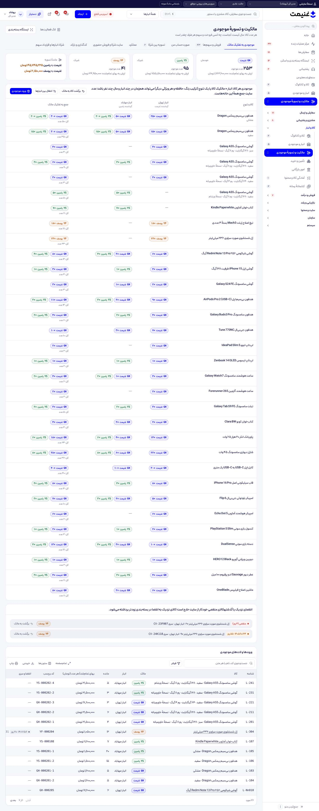
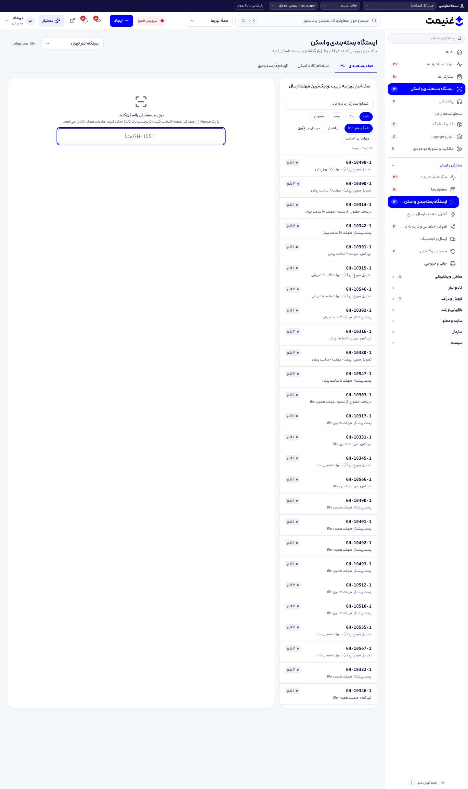
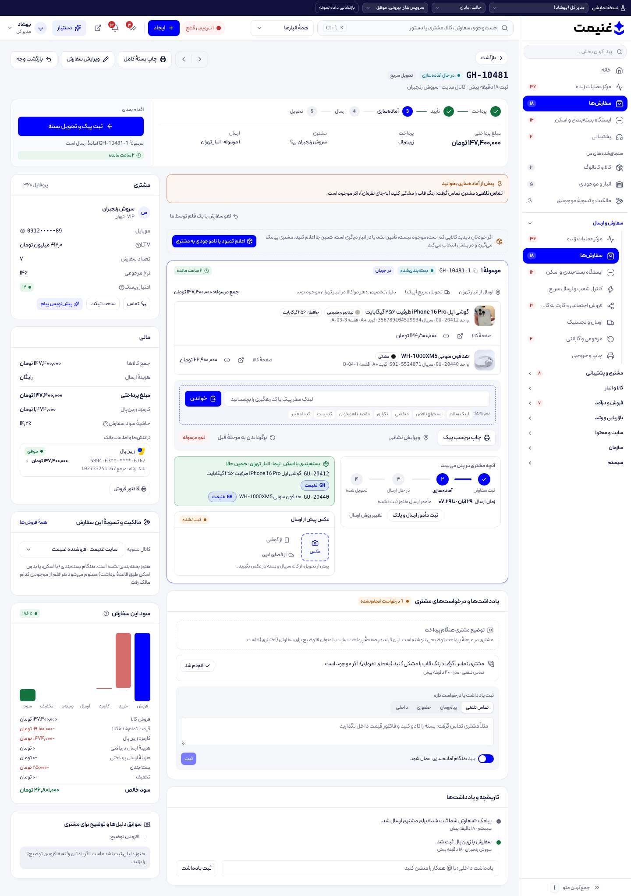

# نسخهٔ v1.5.0 · مالکیت چندگانهٔ موجودی، تسویهٔ خودکار شرکا، ایستگاه بسته‌بندی با بارکدخوان و بازطراحی صفحهٔ سفارش

- تاریخ: ۲۹ آبان ۱۴۰۵
- نسخهٔ قبلی: v1.4.0 (کامیت `d116bc7`؛ `git diff d116bc7 v1.5.0`)
- پیش‌نمایش: https://behshad79.github.io/Ghanimat/

## خلاصه

1. **مالکیت و تسویهٔ موجودی (`/admin/ownership`):** هر عدد کالا سه مشخصه دارد:
   - **مالک:** کسی که پولش را داده؛
   - **انبار:** جایی که کالا هست؛ هر انبار یک گرداننده دارد؛
   - **کانال فروش:** فروشنده، و کسی که پول مشتری به حسابش می‌رود.

   امکانات:
   - **مدل قرارداد** برای هر جفت مالک و فروشنده: تقسیم سود، قیمت توافقی ثابت، یا کمیسیون از مبلغ فروش؛
   - **سهم هر طرف** خودکار حساب می‌شود؛
   - **تخفیف و کارمزد درگاه** به نسبت مبلغ پخش می‌شود (مشترک، یا فقط با فروشنده)؛
   - **صورت‌حساب** از دید هر شریک، با لینک و نمای سریع سفارش؛
   - **گزارش عملکرد** به تفکیک مالک، فروشنده، انبار و کانال؛
   - **ثبت پرداخت تسویه.**
2. **زمان‌بندی پرداخت به شرکا:** سهم هر فروش فقط بعد از دو شرط قابل پرداخت می‌شود:
   - همان پول به حساب ما رسیده باشد (قاعدهٔ هر روش پرداخت؛ مثلاً اسنپ‌پی ۵۰٪ سی روز بعد و ۵۰٪ شصت روز بعد)؛
   - مهلت مرجوعی آن شریک گذشته باشد.

   تسویه سه عدد نشان می‌دهد: مانده کل، قابل پرداخت همین حالا، و «بعداً» با تاریخ هر قسط.
3. **دفتر خودکار شرکا (`ledger`):** هر جای پنل که مرسوله بسته‌بندی، لغو، برگشت یا به عقب برگردانده شود، دفتر خودش را اصلاح می‌کند:
   - تأیید بدون اسکن، مالک را طبق «اولویت برداشت» تعیین می‌کند؛
   - لغو و مرجوعی، ردیف برگشت ثبت می‌کند و موجودی را به همان مالک برمی‌گرداند؛
   - موجودی سایت = موجودی فیزیکی مالکان و انبارهای فعال، منهای رزرو سفارش‌های باز و کالای منقضی.
4. **ایستگاه بسته‌بندی با بارکدخوان (`/admin/packing`):**
   - **بازخورد اسکن:** سبز برای درست؛ قرمز برای کالای اشتباه، تنوع اشتباه با نام دقیق ویژگی (مثلاً «حافظه: ۶۴ به جای ۱۲۸»)، تعداد بیشتر یا سریال دیگر.
   - **داخل صفحهٔ سفارش** هم باز می‌شود، زیر همان مرسوله.
   - **امکانات ایستگاه:** صف قابل فیلتر، تاریخچه با ریز همهٔ اسکن‌ها، و استعلام کالا با اسکن (اطلاعات کامل، سفارش دستی، افزودن به سفارش دیگر، تغییر قیمت).
   - **ورودی:** دوربین گوشی؛ صدا و لرزش.
5. **کدگذاری مالک‌دار:**
   - هر کالای متمایز (هر ترکیب ویژگی: رنگ، حافظه، رم، نسخه و…) برای هر مالک یک کد دارد، مثل `GH-000201-1` و `YS-000201-1`؛
   - بارکد کارخانه یا بارکد اختصاصی شریک هم به کالا، تنوع و مالک وصل می‌شود؛
   - چاپ مستقیم برچسب در گام «بارکد و برچسب» افزودن کالا.
6. **چرخهٔ کامل شریک:**
   - پیوستن شریک تازه در یک فرم: انبار، کانال، قرارداد، حساب کاربری و موجودی اولیه؛
   - ویرایش؛
   - غیرفعال‌سازی با پیش‌نمایش اثر: کالایش ناموجود می‌شود، انبارش بسته و ارسال متوقف می‌شود، مرسوله‌های باز می‌مانند یا منتقل می‌شوند، ورودش بسته می‌شود؛
   - فعال‌سازی دوباره؛
   - حذف فقط بدون سابقه.
   - پرتال شرکای مستقل (`/admin/sellers`) فعلاً غیرفعال و «در انتظار تأیید» است.
7. **تأمین‌کنندهٔ امانی (نمونه: یوسف):**
   - بدون انبار و کانال؛
   - قیمت توافقی ثابت؛
   - تاریخ انقضا و سری ساخت برای هر ورود؛ فروش به ترتیب نزدیک‌ترین انقضا؛ کالای منقضی خودکار از سایت خارج می‌شود؛
   - شناسهٔ سلامت (IRC) برای کالاهای تاریخ‌دار اجباری است؛
   - برگشت کالا به مالک با رسید؛
   - صورت‌حساب چاپی یا PDF و پیامک خلاصه.
8. **اتصال ووکامرس سایت شریک (ve1) و فروش حضوری با اسکن:**
   - صندوق سفارش‌های سایت شریک، با نگاشت SKU؛
   - تشخیص خودکار مالک: اول موجودی خود فروشنده، بعد کالای دیگران؛
   - ارسال موجودی به سایت شریک.
9. **حساب‌ها و دسترسی:**
   - **یاسین:** «مدیر کل دوم (شریک انبار)».
   - **دستیار بهشاد:** «دستیار مدیر کل (همکار اجرایی)».
   - **دادهٔ محرمانهٔ مدیر کل** به‌طور پیش‌فرض بسته است: پرسنل و حقوق، اسناد، تیم و لاگ، تنظیمات و کلیدها، سود کل، بهای تمام‌شده و صورت‌حساب دیگران. کلید «دادهٔ محرمانه» در «تیم و دسترسی» آن را باز می‌کند.
   - **نقش و دسترسی اعضا** را فقط مدیر کل تغییر می‌دهد.
   - **هشدار پیش از اقدام روی سفارش انبار دیگر:** یاسین برای تهران، بهشاد برای مهاباد.
10. **لاگ ممیزی با سند:** هر اقدام با نام، نقش، زمان و فهرست دقیق تغییر داده‌ها ثبت می‌شود (کدام رکورد، کدام فیلد، از چه به چه). فیلتر بر اساس شخص، بخش و «فقط حساس».
11. **صفحهٔ جزئیات سفارش بازطراحی شد:**
    - کارت خلاصه با «اقدام بعدی»؛
    - هشدارها فقط در صورت نیاز؛
    - مرسولهٔ در جریان مشخص؛ اقدام‌های اصلی و حساس جدا؛
    - کارت «مالکیت و تسویهٔ این سفارش» با انتخاب کانال تسویه.

    هیچ قابلیتی حذف نشده است.
12. **منو و سربرگ:**
    - پنج کار روزانه بالای منو، که در گروه خودشان هم تکرار می‌شوند؛
    - گروه‌های آکاردئونی؛
    - شمارندهٔ قرمز فقط برای کار فوری؛
    - کلید `[` برای جمع کردن منو؛
    - سربرگ ساده‌تر با دکمهٔ «ایجاد» (شامل افزودن کالا و ورود موجودی با مالک)؛
    - «کارهای من» در موبایل بر اساس دسترسی نقش.
13. **سایر:**
    - ویرایش و حذف پروندهٔ بازگشت وجه پیش از ارسال به بانک؛
    - ورودی مبلغ با جداکنندهٔ سه‌رقمی، واحد تومان و مبلغ به حروف؛
    - شعب فقط تهران و مهاباد؛
    - دادهٔ نمونهٔ بیشتر: ۲۴ کالا، ۱۲ مشتری، ۳۶ سفارش و ۱۶ دیدگاه.

## صفحه‌ها و مسیرها

| مسیر | تغییر | تصویر |
|---|---|---|
| `/admin/ownership` | تازه: موجودی به تفکیک مالک، فروش و سهم‌ها، صورت‌حساب من، تسویه، عملکرد، سایت شرکا و فروش حضوری، کدگذاری، شرکا و قرارداد |  |
| `/admin/packing` | تازه: صف، استعلام کالا با اسکن، تاریخچهٔ بسته‌بندی |  |
| `/admin/orders/:id` | بازطراحی؛ بسته‌بندی درجا؛ کارت مالکیت و تسویه؛ هشدار انبار دیگر |  |
| `/admin/catalog/new` و `/:id/edit` | گام موجودی: مالک و تقسیم موجودی؛ گام برچسب: چاپ مستقیم | — |
| `/admin/team?tab=audit` | لاگ ممیزی با سند | — |
| `/admin/sellers` | غیرفعال، در انتظار تأیید | — |
| `/admin/branches` | فقط شعبهٔ تهران و مهاباد | — |
| سربرگ و منو | بازچینی | — |

## مدل داده

| مجموعه | فیلد | تغییر | نوع |
|---|---|---|---|
| `stock` | `parties, warehouses, channels, agreements, lots, sales, settlements, codes, codeRule, pickRule, rules, channelMap, ext, payTerms, ownerReturns` | تازه | `StockDB` در `src/shared/data/stock.ts` |
| `stock.lots` | `expiry, batch, hold` | تازه | تاریخ و رشته |
| `stock.sales` | `qty` منفی برای برگشت؛ `shipId, unitId, discount, fee, auto, reversal, ext` | تازه | |
| `stock.agreements` | `model: profit_share \| fixed_price \| commission` | تازه | |
| `stock.parties` | `payout { cycle, holdDays, minShelfDays }`، `userId, account, offAt…` | تازه | |
| `products` | `owner, needsExpiry, irc` | تازه | |
| `units` | `owner` | تازه | |
| `orders.shipments` | `pack { at, by, station, scans[] }` | تازه | |
| `orders` | `salesChannel` | تازه | کانال تسویهٔ دستی |
| `audit` | `role, changes[], sensitive` | تازه | `AuditEntry` |
| `roleDefs` | نقش‌های `cofounder` و `assistant`؛ فیلد `deny[]` | تازه | |
| `access[uid].add` | `secrets` | تازه | باز کردن دادهٔ محرمانه |
| `team` | `u9` دستیار بهشاد؛ نقش `u4` به `cofounder` | تغییر | |
| `partners` | وضعیت همه «در انتظار تأیید» | تغییر | |
| `DB_KEY` | `ghanimat-demo-db-v81` | تغییر | |

## وضعیت‌ها و قانون‌ها

- **قاعدهٔ تقسیم:** `split()` در `stock.ts`. جمع سهم مالک، سهم فروشنده و هزینهٔ ارسال همیشه برابر است با مبلغ دریافتی منهای کارمزد.
- **قاعدهٔ زمان پرداخت:** `tranches()` و `payoutBetween()` در `payout.ts`. تاریخ هر قسط = دیرترینِ (رسیدن پول آن قسط) و (تحویل + مهلت مرجوعی شریک دریافت‌کننده).
- **اولویت برداشت:** `partner_first` (پیش‌فرض)، `own_first`، `fifo` یا `cost_low`. لات‌های تاریخ‌دار همیشه با نزدیک‌ترین انقضا اول برداشته می‌شوند.
- **قفل ویرایش و حذف بازگشت وجه:** فقط در وضعیت‌های `requested`، `approved` و `failed` مجاز است. تغییر مبلغ یا مقصد در `approved`، پرونده را به `requested` برمی‌گرداند.

## عملیات و API

| endpoint پیشنهادی | عملیات در کد (فایل:خط) | توضیح |
|---|---|---|
| `POST /stock/lots` | `IntakeModal` در `src/admin/stock/Ownership.tsx` | ورود موجودی با مالک، انقضا، سری و IRC |
| `POST /stock/transfers` | `MoveModal` در `Ownership.tsx` | انتقال بین انبارها (مالک ثابت) |
| `POST /shipments/:id/pack` | `PackSession.finish` در `src/admin/stock/Packing.tsx` و `recordShipment` در `src/shared/data/ledger.ts` | ثبت اسکن‌ها، کم کردن لات مالک، ساخت ردیف فروش |
| رویداد تغییر وضعیت مرسوله | `ledgerHook` در `src/shared/data/ledger.ts` | تخصیص خودکار، برگشت در لغو، مرجوعی و عقب‌گرد |
| `GET /settlements/:a/:b` | `payoutBetween` در `src/shared/data/payout.ts` | مانده، قابل پرداخت، اقساط بعدی |
| `POST /settlements` | `SettleModal` در `Ownership.tsx` | ثبت پرداخت تسویه |
| `POST /owner-returns` | `OwnerReturnModal` در `Ownership.tsx` | برگشت کالا به مالک با رسید |
| `POST /partners`، `PATCH /partners/:id`، `POST /partners/:id/deactivate` | `PartyJoin`، `PartyEdit` و `PartyOff` در `src/admin/stock/Parties.tsx` | چرخهٔ کامل شریک |
| وب‌هوک `POST /hooks/woo/:partyId` | `ExtCard` در `src/admin/stock/ExtSites.tsx` | دریافت سفارش ووکامرس (order.created/updated/refunded) |
| `GET /scan/:code` | `resolveCode` در `Packing.tsx` و `Inspect` در `src/admin/stock/Inspect.tsx` | شناسایی کد ← کالا، تنوع، مالک |
| `PATCH /refunds/:id`، `DELETE /refunds/:id` | `RefundRow` در `src/admin/orders/Refunds.tsx` | ویرایش و حذف پیش از ارسال به بانک |
| ثبت ممیزی سمت سرور | `mutate` و `diffDB` در `src/shared/lib/store.ts` | سند خودکار تغییرها |

## سیستم طراحی

- `MoneyInput` در `src/shared/ui/money.tsx`: جداکنندهٔ سه‌رقمی، واحد، و `moneyWords()` برای مبلغ به حروف.
- `printSolo` در `src/shared/lib/printSolo.ts`: چاپ فقط یک بخش از صفحه.
- `PartyChip`: برچسب رنگی مالک با پیشوند کد.
- رنگ بازخورد اسکن: سبز `#12733f` و قرمز `#c42f2f`.

## کارهای توسعه

- [ ] جدول‌های `parties`، `warehouses`، `channels`، `agreements`، `lots`، `sales`، `settlements`، `owner_returns` و `pay_terms` با کلید خارجی به محصول، تنوع، سفارش و مرسوله
- [ ] پیاده‌سازی `ledgerHook` به‌صورت رویداد سمت سرور روی تغییر وضعیت مرسوله و مرجوعی (اتمیک با تغییر وضعیت)
- [ ] محاسبهٔ موجودی سایت از لات‌ها منهای رزرو، و حذف کالای منقضی با کار زمان‌بندی‌شدهٔ روزانه
- [ ] اتصال گزارش تسویهٔ واقعی درگاه‌ها و اقساطی‌ها (اسنپ‌پی، دیجی‌پی، ترب‌پی) به‌جای قاعدهٔ ثابت `payTerms`
- [ ] وب‌هوک و REST ووکامرس برای سایت شرکا، با امضای HMAC و نگاشت SKU
- [ ] ایستگاه بسته‌بندی: پشتیبانی از بارکدخوان (keyboard wedge) و `BarcodeDetector` روی دستگاه‌های انبار
- [ ] نقش‌های `cofounder` و `assistant`، فیلد `deny`، کلید `secrets` و فیلتر دادهٔ محرمانه در API (نه فقط در رابط)
- [ ] لاگ ممیزی سمت سرور، غیرقابل ویرایش، با diff
- [ ] چاپ برچسب حرارتی ۵۰×۳۰ با کد مالک‌دار
- [ ] پیامک صورت‌حساب شریک و لینک فقط‌خواندنی امضاشده

## فایل‌های تغییرکرده

`git diff --stat d116bc7 HEAD`: ۶۳ فایل، ۲۹۴۵ خط افزوده، ۲۴۰ خط حذف. فایل‌های اصلی:
`src/admin/stock/*` (تازه)، `src/shared/data/stock.ts`، `ledger.ts` و `payout.ts` (تازه)، `src/admin/pages/Orders.tsx`، `src/admin/shell/Shell.tsx`، `src/admin/shell/nav.ts`، `src/admin/catalog/Wizard.tsx`، `src/admin/catalog/WizardLabels.tsx`، `src/admin/team/AuditLog.tsx`، `src/admin/orders/Refunds.tsx`، `src/shared/lib/store.ts`، `src/shared/data/seed.ts` و `src/shared/data/roles.ts`.
